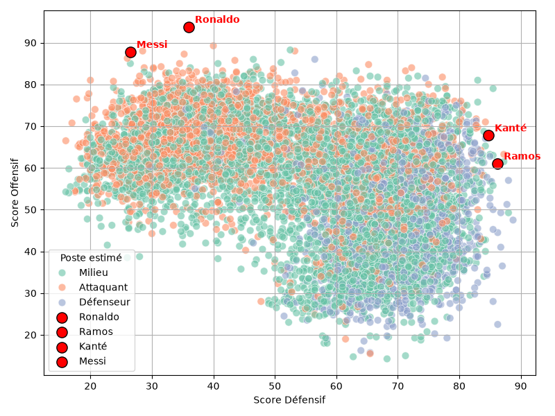

# Football Scouting : analyse de données et recommandation de poste

Projet d'algorithmie appliquée réalisé en équipe de quatre à l'ENSAI (1re année, février – mai 2025), en Python.

Le projet exploite la base [European Soccer Database](https://www.kaggle.com/datasets/hugomathien/soccer)
(25 979 matchs, 11 championnats européens, 8 saisons) avec deux objectifs :

1. **Répondre à des questions d'analyse** sur les matchs, les équipes et les joueurs, en programmant chaque
   traitement deux fois, **avec et sans pandas**, pour comparer les performances.
2. **Construire un outil de scouting** : à partir des caractéristiques d'un joueur (notes de 0 à 99), l'application
   recommande le **poste le plus probable** et propose les **joueurs les plus similaires** de la base.



## Outil de scouting

### Démarche

Le module [`src/Clustering.py`](src/Clustering.py) procède en quatre étapes :

1. **Préparation.** On garde la fiche la plus récente de chaque joueur et on exclut les gardiens (notes de gardien
   supérieures à 30), car ils ont un profil à part.
2. **Scores synthétiques.** Deux indicateurs résument le profil :
   - *score offensif* : moyenne de `finishing`, `shot_power`, `long_shots` et `positioning` ;
   - *score défensif* : moyenne de `marking`, `standing_tackle`, `interceptions` et `aggression`.
3. **Étiquetage des postes.** La base ne fournit pas le poste des joueurs. On l'estime à partir de l'implication
   déclarée (*work rate*) : un joueur plus impliqué en attaque qu'en défense est classé attaquant, l'inverse
   défenseur, et milieu en cas d'égalité.
4. **Recommandation par k plus proches voisins.** On recherche les 5 joueurs les plus proches du profil saisi dans
   l'espace des 8 attributs (`NearestNeighbors` de scikit-learn, distance euclidienne). Le poste recommandé est
   celui qui revient le plus souvent parmi ces voisins.

### Exemple

Toni Kroos est retiré de la base, puis on saisit ses statistiques comme pour un joueur inconnu :

| Joueur similaire  | Poste estimé |
|-------------------|--------------|
| Maximilian Arnold | Attaquant    |
| Miralem Pjanić    | Milieu       |
| Daniel Wass       | Milieu       |
| Vladimir Darida   | Milieu       |
| Ivan Rakitić      | Milieu       |

**Poste recommandé : Milieu.** C'est bien le poste de Kroos, et les voisins trouvés sont des milieux
relayeurs au profil comparable.

### Limites

- Le poste « réel » est une approximation tirée des *work rates*. Le modèle apprend donc à reproduire cette règle,
  pas les postes officiels.
- Les 8 attributs ont tous le même poids. Avec un jeu de postes réels, on pourrait passer à une classification
  supervisée évaluée sur un jeu de test.

## Questions d'analyse

Chaque membre de l'équipe a traité trois questions ([`src/questions.py`](src/questions.py)) :

| Auteur  | Question | Exemple de résultat |
|---------|----------|---------------------|
| Adam    | Équipe la plus victorieuse de chaque saison dans une ligue | Liga BBVA : Barcelone (27 victoires en 2008/2009) |
| Adam    | Match avec le plus large écart de buts | PSV 10 – 0 Feyenoord (Eredivisie 2010/2011) |
| Adam    | Victoire la plus improbable selon les cotes Bet365 (domicile / extérieur / nul) | Barcelone 0 – 2 Hércules, cote de 34 (2010) |
| Ilona   | Nombre moyen de buts par match pour une ligue et une saison | 2,79 buts par match (Belgique, 2008/2009) |
| Ilona   | Meilleur joueur selon un attribut | Dribble : Ronaldo, Messi, Ronaldinho (97) |
| Ilona   | Équipe ayant encaissé le plus de buts | |
| Anis    | Score le plus fréquent | 1 – 1 (3 014 matchs) |
| Anis    | Classement d'une ligue sur une saison | |
| Anis    | Taux de victoire à domicile, de nuls et à l'extérieur | Ligue 1 2015/2016 : 42 % / 28 % / 30 % |
| Aliaume | Équipe ayant perdu le plus de matchs | Kilmarnock (142 défaites) |
| Aliaume | Équipes avec le plus de *clean sheets* | Premier League 2013/2014 : Chelsea (18) |
| Aliaume | Âge moyen des effectifs | Boxplot, Premier League 2013/2014 |

### Avec ou sans pandas ?

Plusieurs questions existent en deux versions : l'une avec pandas, l'autre en Python pur (`csv`, dictionnaires,
boucles). [`src/compare_time.py`](src/compare_time.py) mesure les temps d'exécution :

| Question | Python pur | pandas | Gain |
|----------|-----------:|-------:|-----:|
| Victoire la plus improbable (Adam) | 0,43 s | 0,07 s | × 6 |
| Meilleur joueur par attribut (Ilona) | 1,24 s | 0,24 s | × 5 |
| Score le plus fréquent (Anis) | 0,27 s | 0,16 s | × 1,7 |
| Équipe la plus battue (Aliaume) | 0,37 s | 0,32 s | × 1,2 |

*Mesures indicatives sur un ordinateur portable.* Le gain est net sur les traitements qui filtrent ou agrègent
de gros volumes, grâce aux opérations vectorisées. Il devient faible quand la lecture du fichier domine.

## Installation et utilisation

```bash
git clone https://github.com/AdamLaporte/football-scouting.git
cd football-scouting
python -m venv .venv && source .venv/bin/activate
pip install -r requirements.txt
```

Télécharger et préparer les données en suivant [`data/README.md`](data/README.md), puis :

```bash
python main.py
```

Le programme répond à toutes les questions, compare les temps d'exécution, génère la carte des joueurs, puis
**demande les 8 attributs d'un joueur** (entiers de 0 à 99) pour lancer la recommandation. Les résultats (CSV, TXT
et PNG) sont enregistrés dans `results/`, avec un sous-dossier par partie.

Tests unitaires :

```bash
python -m pytest
```

## Structure

```
football-scouting/
├── main.py                 # point d'entrée : questions, temps, scouting
├── src/
│   ├── clean_data.py       # nettoyage des matchs et découpage par saison
│   ├── questions.py        # les 12 questions d'analyse (avec et sans pandas)
│   ├── compare_time.py     # benchmark pandas / Python pur
│   └── Clustering.py       # carte des joueurs et recommandation de poste (k-NN)
├── scripts/
│   └── export_sqlite.py    # export de la base Kaggle en CSV
├── tests/
│   └── test_questions.py   # tests unitaires (unittest / pytest)
└── data/README.md          # source et préparation des données
```

## Stack

Python · pandas · scikit-learn · matplotlib · seaborn · unittest / pytest · flake8 / black

## Auteurs

Ilona Martinez-Gutmann, Adam Laporte, Anis Zebiche, Aliaume Saignat. Voir [AUTHORS.md](AUTHORS.md).
Ce dépôt reprend le projet d'origine (développé sur GitLab), légèrement nettoyé et documenté.
